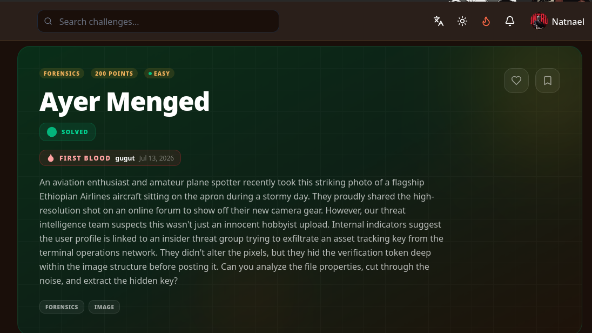

# Ayer Menged — EXIF Hidden Token

> **Author:** mr.p4rr0t • **Tag:** `#mr.p4rr0t`



## Challenge

> An aviation enthusiast posted a photo of an Ethiopian Airlines aircraft on a forum. An insider threat group allegedly hid an asset tracking key in the image structure. Extract the hidden verification token.

## Solution

### 1. Initial Analysis

The challenge provides a ZIP archive containing a single JPEG (`ayer_menged.jpg`, ~1.2 MB).

Check the file type and extract metadata:

```bash
$ file ayer_menged.jpg
$ exiftool ayer_menged.jpg
```

The image is a legitimate photograph (Fujifilm X-T5, 3264×2448, taken near Bole International Airport, Addis Ababa).

### 2. EXIF Metadata Inspection

The EXIF dump reveals a long list of standard camera metadata — make, model, lens, GPS coordinates, aperture, shutter speed, ICC profile, etc. One field stands out:

| Field | Value |
|---|---|
| `User Comment` | `Terminal Logs: Route tracking key confirmed. Flag: [REDACTED]` |

The challenge warned to "cut through the noise" — the flag was buried among 50+ EXIF fields of legitimate camera data.

## Flag

```
[REDACTED]
```

Decoded: "ayer menged osint verified"

## Key Takeaways

- When a challenge says data is hidden "in the image structure, not the pixels," check **EXIF metadata** before attempting LSB steganography.
- Tools like `exiftool` can dump all embedded metadata fields — the signal is often in an overlooked comment or custom field.
