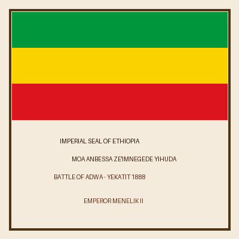

# The Emperor's ማህተም — PNG Structure Carving

> **Author:** mr.p4rr0t • **Tag:** `#mr.p4rr0t`

> ADWA CTF · **Forensics / Steganography** · 150 pts



> A courier galloping south from Emperor Menelik's war camp carried an embroidered woodcut banner depicting the Imperial Seal of Ethiopia (Moa Anbessa).
>
> Italian border sentries inspected the parchment but found only an artistic rendering of the imperial tricolor and motto. However, our intelligence officers suspect the courier concealed a secret imperial decree inside the file.
>
> Analyze the image structures to carve out the hidden proclamation and recover the flag.

**Flag:** `[REDACTED]`

---

## Challenge Overview

The challenge presents a PNG image depicting the Ethiopian Imperial tricolor (Green, Gold, Red) inscribed with the historical motto:
- `IMPERIAL SEAL OF ETHIOPIA`
- `MOA ANBESSA ZE'IMNEGEDE YIHUDA` (Conquering Lion of the Tribe of Judah)
- `BATTLE OF ADWA - YEKATIT 1888`
- `EMPEROR MENELIK II`

Visual inspection and typical LSB extraction yield no obvious payload. The challenge prompt points to inspecting the underlying **file structure** rather than pixel values alone.

---

## Reconnaissance & File Structure Analysis

### 1. Basic Inspection

Checking file type and dimensions:

```bash
$ file seal.png
seal.png: PNG image data, 400 x 400, 8-bit/color RGB, non-interlaced
$ ls -l seal.png
-rw-r--r-- 1 nate nate 7500 Nov 14 23:54 seal.png
```

The file size is exactly 7,500 bytes.

### 2. PNG Chunk Structure Verification

A valid PNG stream consists of an 8-byte signature (`\x89PNG\r\n\x1a\n`) followed by a series of chunks. Each chunk has:
- **Length**: 4 bytes (big-endian integer)
- **Type**: 4 ASCII bytes (e.g., `IHDR`, `IDAT`, `IEND`)
- **Data**: *Length* bytes
- **CRC**: 4 bytes

The standard requires the file stream to terminate with an `IEND` chunk (0 bytes length, type `IEND`, and 4-byte CRC).

Parsing the chunk boundaries with Python:

```python
import struct

with open("seal.png", "rb") as f:
    data = f.read()

idx = 8
while idx < len(data):
    if idx + 8 > len(data):
        print(f"Extra data at end: {len(data) - idx} bytes at offset {idx}")
        break
    length, ctype = struct.unpack(">I4s", data[idx:idx+8])
    ctype_str = ctype.decode("latin1", errors="replace")
    print(f"Chunk {ctype_str} (length {length}) at offset {idx}")
    idx += 8 + length + 4
    if ctype_str == "IEND":
        break

if idx < len(data):
    print(f"Trailing data beyond IEND: {len(data) - idx} bytes starting at offset {idx}")
    print("Header bytes:", data[idx:idx+16])
```

Output:

```text
Chunk IHDR (length 13) at offset 8
Chunk IDAT (length 6993) at offset 33
Chunk IEND (length 0) at offset 7038
Trailing data beyond IEND: 450 bytes starting at offset 7050
Header bytes: b'PK\x03\x04\x14\x00\x00\x00\x08\x00...'
```

---

## Carving & Extraction

The 450 bytes trailing immediately after the `IEND` chunk (offset `7050` / `0x1B8A`) begin with `PK\x03\x04`, the standard magic header for a **ZIP archive** (`0x04034b50`).

Image renderers stop parsing at `IEND`, leaving any trailing overlay invisible to standard viewing tools.

### Extraction Script

```python
import zipfile
import io

with open("seal.png", "rb") as f:
    data = f.read()

# Carve from offset 7050 to the end of file
zip_payload = data[7050:]

with zipfile.ZipFile(io.BytesIO(zip_payload)) as archive:
    print("Archive files:", archive.namelist())
    for fname in archive.namelist():
        content = archive.read(fname).decode("utf-8")
        print(f"\n--- {fname} ---")
        print(content)
```

### Recovered Imperial Proclamation

Extracting the embedded `imperial_proclamation.txt`:

```text
IMPERIAL WAR PROCLAMATION (KITET AWAJ)
Issued by His Imperial Majesty Atse Menelik II, King of Kings of Ethiopia:
Courier Verification ID: 6a3e8d11e6dcc2e51f4e806f

An enemy has come from across the sea to subvert our country and destroy our faith.
He has begun to encroach on our borders. Now, rise up and defend your heritage!

Royal Order Clearance Flag:
[REDACTED]
```

---

## Flag

```
[REDACTED]
```

---

## Key Takeaways

1. **PNG Overlay / Append Steganography**: Standard image viewers cease decoding upon encountering the `IEND` chunk. Any payload appended past this boundary remains untouched and invisible during normal rendering.
2. **Chunk Boundary Verification**: Verifying the file size against the byte offsets calculated by chunk lengths (`8 + length + 4`) quickly highlights overlay payloads.
3. **Magic Byte Identification**: Identifying the `PK\x03\x04` signature allowed immediate identification of a ZIP container, permitting direct extraction using `unzip`, `binwalk`, or Python's `zipfile` module.
