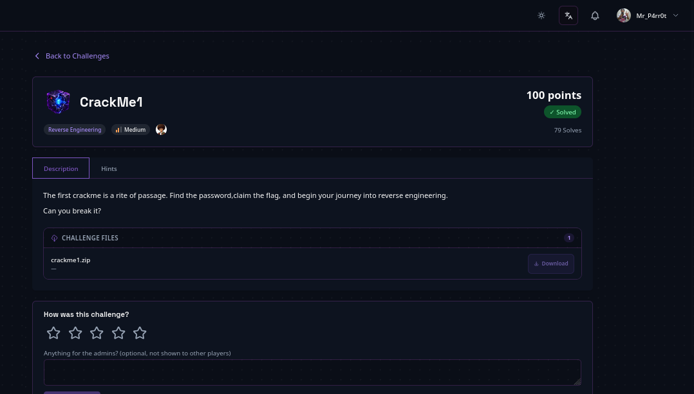

# CrackMe1 — ELF Binary

> **Author:** mr.p4rr0t • **Tag:** `#mr.p4rr0t`



## Challenge

A beginner-level BunaByte crackme shipped as a zip archive containing a single 64-bit ELF binary. The program asks for a password; the correct password unlocks an XOR-encrypted flag. Nothing is stripped, so the entire validation logic is readable from symbols, strings, and a quick disassembly.

**Files:** `crackme1.zip` → `crackme1` (ELF 64-bit, not stripped, with debug info)

## Solution

### 1. Extract the Challenge Files

```bash
unzip -o crackme1.zip -d crackme1
Archive: crackme1.zip
  inflating: crackme1/crackme1
```

The extracted archive contains a single binary: `crackme1`.

### 2. Identify the Binary

```bash
file crackme1/crackme1
```

Output:

```
crackme1/crackme1: ELF 64-bit LSB pie executable, x86-64, version 1
(SYSV), dynamically linked, interpreter /lib64/ld-linux-x86-64.so.2,
BuildID[sha1]=9dd5c7b41011100514165997382d0d7a6a42d8d9,
for GNU/Linux 3.2.0, with debug_info, not stripped
```

Key observations:

- 64-bit ELF binary (Linux)
- Dynamically linked (uses libc/libstdc++)
- **NOT stripped** — symbols are available for analysis
- Compiled with GCC 15.2.0, C++17, debug symbols (`-g -O0`)
- Source file reference: `crackme1.cpp`

Because the binary is not stripped, symbol names reveal the program's structure without having to reverse anonymous functions.

### 3. Extract Strings from the Binary

```bash
strings crackme1/crackme1
```

Key strings found:

```
[Prompts and Messages]
"=== Welcome to Bunabyte Easy CrackMe Challenge==="
"Enter the password to access internal systems: "
"Correct password! Access granted."
"Incorrect password! Access denied."

[Encoded/Encrypted Data]
"U3VwZXJTZWNyZXRQYSQkdzByZA=="      <-- base64 string
"uulte#t|z$H&dHy'cHd'Hr#dnj"        <-- XOR-encrypted flag

[Variable Names / Symbols]
"correct_encoded"    (debug info for the expected base64 value)
"flag_encoded"       (debug info for the encrypted flag)
"input_encoded"      (debug info for user input after encoding)
"real_flag"          (debug info for the decrypted flag)

[Function Reference]
"base64_encode"      <-- the program uses base64 encoding

[Base64 Alphabet]
"ABCDEFGHIJKLMNOPQRSTUVWXYZabcdefghijklmnopqrstuvwxyz0123456789+/"
```

At this point the hypothesis is strong: the program base64-encodes the user input and compares it to a hardcoded value, and the flag is XOR-encrypted.

### 4. Decode the Base64 String

```bash
echo "U3VwZXJTZWNyZXRQYSQkdzByZA==" | base64 -d
SuperSecretPa$$w0rd
```

This is the expected password. Whatever the user types is base64-encoded and compared against the hardcoded base64 string.

### 5. Verify by Running the Binary

```bash
echo "SuperSecretPa$$w0rd" | ./crackme1
```

Output:

```
=== Welcome to Bunabyte Easy CrackMe Challenge===
Enter the password to access internal systems: Correct password! Access granted.
Flag: [REDACTED]
```

Flag obtained.

### 6. Analyze the Disassembly (Deep Dive)

```bash
objdump -d crackme1/crackme1
```

**`main()` function at address `0x2412`**

1. **Print welcome message** — loads the addresses of the welcome strings and outputs them via `std::cout` (`operator<<` calls).
2. **Read user input** — `std::getline(std::cin, input)` reads the password from stdin, storing it in a `std::string` at `[rbp-0x70]`.
3. **Base64-encode the input** — calls `base64_encode(input)` at address `0x2209`:
   - Uses the standard base64 alphabet: `ABCDEFGHIJKLMNOPQRSTUVWXYZabcdefghijklmnopqrstuvwxyz0123456789+/`
   - Standard base64 implementation: reads 3 bytes at a time, shifts and masks to extract 6-bit groups, maps each 6-bit value to the alphabet, appends `=` padding as needed
   - Result stored in a `std::string`
4. **Compare to hardcoded value** — the hardcoded `U3VwZXJTZWNyZXRQYSQkdzByZA==` is loaded into a `std::string` at `[rbp-0x90]`; `std::operator==()` compares the encoded input against it. If not equal, jumps to the "Incorrect password" branch.
5. **Decrypt the flag (if password correct)** — loads the encrypted flag `uulte#t|z$H&dHy'cHd'Hr#dnj`, iterates over each character in a for loop, XORing every byte with `0x17`:

   ```asm
   movzbl (%rax),%eax        # load byte from flag_encoded
   xor    $0x17,%eax         # XOR with 0x17
   ```

   The decrypted byte is stored in the `real_flag` string. The loop lives at `0x2578`–`0x25df`.
6. **Output the flag** — prints `"Correct password! Access granted."` then `"Flag: "` followed by the decrypted `real_flag`, using `std::cout` and `std::endl`.

**XOR decryption verification**

```
flag_encoded:  u  u  l  t  e  #  t  |  z  $  H  &  d  H  y  '
XOR 0x17:      b  b  {  c  r  4  c  k  m  3  _  1  s  _  n  0
flag_encoded:  c  H  d  '  H  r  #  d  n  j
XOR 0x17:      t  _  s  0  _  e  4  s  y  }

Full flag: [REDACTED]
```

## Flag

```
[REDACTED]
```

## Key Takeaways

- **String extraction** — hardcoded values are findable with `strings`; no disassembly was needed to recover the password.
- **Base64 recognition** — the `==` padding and the trailing `=` alphabet string are dead giveaways; decoding the hardcoded blob yields the plaintext password.
- **ELF binary analysis** — `file` output (PIE, dynamically linked, not stripped, debug info) tells you how much effort static analysis will take.
- **Single-byte XOR** — the flag is protected by a trivial XOR cipher with key `0x17`, visible directly in the disassembly as `xor $0x17,%eax`.
- **Disassembly as verification** — the objdump walk-through confirms the strings-based hypothesis instead of guessing.

Related: the sibling challenge [[CrackMe2 — ELF Binary]] uses the same shape (hardcoded check + XOR flag, key `0x42`), and [[XOR Protector — Single Byte XOR]] explores the same single-byte XOR technique in isolation.
