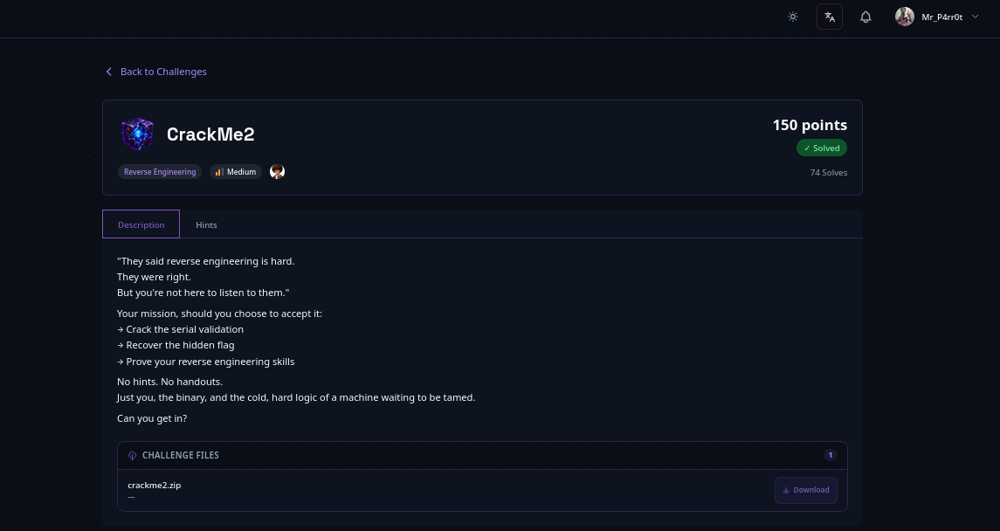

# CrackMe2 — ELF Binary

> **Author:** mr.p4rr0t • **Tag:** `#mr.p4rr0t`



## Challenge

The medium-difficulty follow-up to [[CrackMe1 — ELF Binary]]. Instead of a single password check, this crackme validates a **username/serial pair**: a deterministic algorithm derives the expected serial from the username, and the flag is constructed at runtime from stack-encoded bytes. The binary is not stripped, so function names do most of the work.

**Files:** `crackme2.zip` → `crackme2` (ELF 64-bit, not stripped, with debug info)

## Solution

### 1. Extract and Identify the Binary

```bash
unzip crackme2.zip -d crackme2
file crackme2/crackme2
crackme2/crackme2: ELF 64-bit LSB pie executable, x86-64, version 1
(SYSV), dynamically linked, with debug_info, not stripped
```

Same as CrackMe1: a 64-bit C++ binary with debug symbols. The source file reference is `crackme2.cpp`.

### 2. Extract Strings

```bash
strings crackme2/crackme2
```

Key strings found:

```
[Prompts]
"===BunaByte CrackMe Medium Challenge==="
"Username: "
"Too short."
"Serial: "
"[+] Access Granted!"
"[-] Access Denied!"

[Function Names (from debug symbols)]
"generateSerial"   -- generates expected serial from username
"getFlag"          -- produces the flag string
"username"         -- variable name
```

This is a **serial validation** crackme: enter a username and a serial; the program checks whether the serial is correct for that username.

### 3. Disassemble the Binary

```bash
objdump -d crackme2/crackme2
```

Three key functions to analyze:

1. `_Z7getFlagB5cxx11v` (getFlag)       at `0x2209`
2. `_Z14generateSerial...` (generateSerial) at `0x22f1`
3. `main`                 at `0x24f1`

### 4. Analyze the `getFlag` Function

The `getFlag` function constructs the flag at runtime:

1. Loads 25 encoded bytes onto the stack via four `movabs` instructions:

   ```asm
   movabs $0x372b26272f392020, %rax   -> stored at -0x40(%rbp)
   movabs $0x2f29212330211d2f, %rdx   -> stored at -0x38(%rbp)
   movabs $0x272f29212330211d, %rax   -> stored at -0x37(%rbp)
   movabs $0x3f2627342e2d311d, %rdx   -> stored at -0x2f(%rbp)
   ```

2. The 25 encoded bytes in memory (little-endian, with overlaps resolved by last-write-wins):

   ```
   20 20 39 2f 27 26 2b 37
   2f 1d 21 30 23 21 29 2f
   27 1d 31 2d 2e 34 27 26 3f
   ```

3. Loops `i = 0` to `24` (`0x18`):
   - Loads `encoded[i]`
   - XORs with `0x42`
   - Appends the result to the output string

4. Decoding:

   ```
   encoded:  20 20 39 2f 27 26 2b 37 2f 1d 21 30 23 21 29 2f
            27 1d 31 2d 2e 34 27 26 3f

   XOR 0x42: 62 62 7b 6d 65 64 69 75 6d 5f 63 72 61 63 6b 6d
            65 5f 73 6f 6c 76 65 64 7d

   Decoded:  b  b  {  m  e  d  i  u  m  _  c  r  a  c  k  m
            e  _  s  o  l  v  e  d  }
   ```

**Flag:** `[REDACTED]`

### 5. Analyze the `generateSerial` Function

`generateSerial` takes a username and produces the expected serial. For each character `c` at index `i` in the username:

```
temp = (ord(c) * (i + 1) + 0x42) // 2
val = temp % 62

Character mapping:
  0-25:   val + 'A'   (A-Z)
  26-51:  val + 'a'   (a-z)
  52-61:  val - 4     (0-9)
```

After the loop, append:

- `char = (length * 7) % 26 + 'A'`
- `username[0]`
- `username[length-1]`

Example for username `"admin"`:

```
a(97)*1=97+66=163//2=81%62=19 -> T
d(100)*2=200+66=266//2=133%62=9 -> J
m(109)*3=327+66=393//2=196%62=10 -> K
i(105)*4=420+66=486//2=243%62=57 -> 5
n(110)*5=550+66=616//2=308%62=34 -> 8
length=5: (5*7)%26=35%26=9 -> J
First char: a
Last char: n
Serial: TJK58Jan
```

### 6. Analyze the `main` Function

The `main` function flow:

1. Print welcome banner
2. Read username via `getline(cin, username)`
3. Remove spaces from username (`std::remove` + `erase`)
4. Check if username length ≤ 3: print `"Too short."` and exit
5. Print `"Serial: "`
6. Read serial via `getline(cin, serial)`
7. Remove spaces from serial
8. Call `generateSerial(username)` to compute the expected serial
9. Compare computed serial with the user-provided serial
10. If match: print `"[+] Access Granted!"` and call `getFlag()`
11. If no match: print `"[-] Access Denied!"`

Key detail: both username and serial have spaces removed before processing, so spaces in the input are irrelevant.

### 7. Run the Binary (Optional Verification)

For username `"admin"` with serial `"TJK58Jan"`:

```bash
echo -e "admin\nTJK58Jan" | ./crackme2
```

Note: due to how `getline` handles piped input, the binary may not process both lines correctly in a non-interactive shell. The flag can be obtained directly from the `getFlag` analysis without running the binary at all.

## Flag

```
[REDACTED]
```

## Key Takeaways

- **Serial validation** — the program derives the serial from the username with a deterministic algorithm, then compares it to user input.
- **Runtime flag construction** — the flag is not stored as a plaintext string; it is 25 bytes of stack-encoded data decoded at runtime via XOR with `0x42`.
- **Symbol analysis** — because the binary is not stripped, names like `getFlag` and `generateSerial` reveal the program's structure immediately.
- **Single-byte XOR** — the flag uses a simple XOR cipher with key `0x42` — the same key as [[XOR Protector — Single Byte XOR]] and the same technique as [[CrackMe1 — ELF Binary]] (key `0x17`).
- **Shortest path to the flag** — you never need to fully understand the serial algorithm: `getFlag()` is self-contained and its encoding is straightforward, so the flag can be decoded straight from the disassembly. You just need to reach the "Access Granted" branch — or skip running the binary entirely.

Related: [[CrackMe1 — ELF Binary]] is the beginner sibling in the same BunaByte series.
