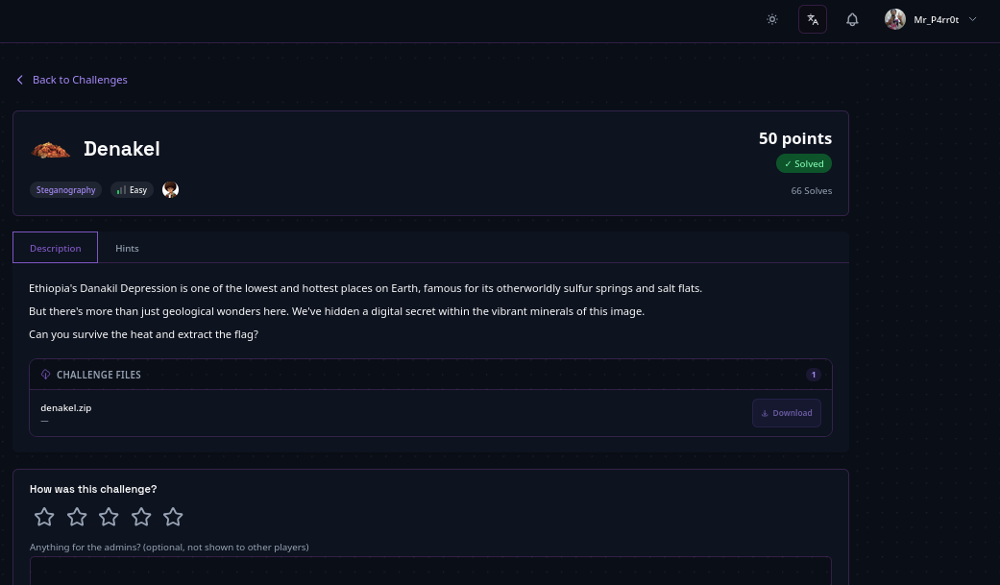

# Danakil Depression — PNG LSB

> **Author:** mr.p4rr0t • **Tag:** `#mr.p4rr0t`



> Ethiopia's Danakil Depression stego challenge: a base64-encoded flag hidden in the least significant bits of a PNG's RGBA channels.

**Flag:** `[REDACTED]`

## Challenge

A ZIP archive containing a PNG image themed on the Danakil Depression in Ethiopia. The flag is hidden with LSB (least significant bit) steganography and recovered with `zsteg`.

## Reconnaissance

1. **Unzip the provided file**

```bash
unzip denakel.zip
```

Extracts a single file: `denakel.png` (1595x1054, RGBA PNG).

2. **Examine the image.** Basic inspection (`file`, `exiftool`, `strings`) reveals nothing obvious. `strings` shows a fragment `FBB{` but no full flag.

## Solution

1. **Run zsteg (PNG LSB stego detector)**

```bash
zsteg denakel.png
```

Among many results, one line stands out:

```
b1,rgba,lsb,xy  .. text: "[REDACTED]"
```

This is a base64-encoded string hidden in the least significant bits of the RGBA color channels.

2. **Decode the base64 string**

```bash
echo "[REDACTED]" | base64 -d
```

Result:

```
[REDACTED]
```

## Flag

```
[REDACTED]
```

## Context

The Danakil Depression in Ethiopia is one of the hottest places on Earth and a significant paleoanthropological site. The flag references Ethiopia as "the cradle of humanity" (`cr4dl3_of_hum4n1ty`), where some of the oldest hominid fossils (like Lucy) were discovered.

## Key Takeaways

- `zsteg` is the go-to tool for detecting LSB-embedded data in PNG images.
- Always check all bit planes and color channels when looking for stego.
- Base64 hidden in LSB is a common CTF technique.
- The same LSB-in-PNG technique appears with a manual extraction twist in [[Phishing Invoice — Email + PNG]].
