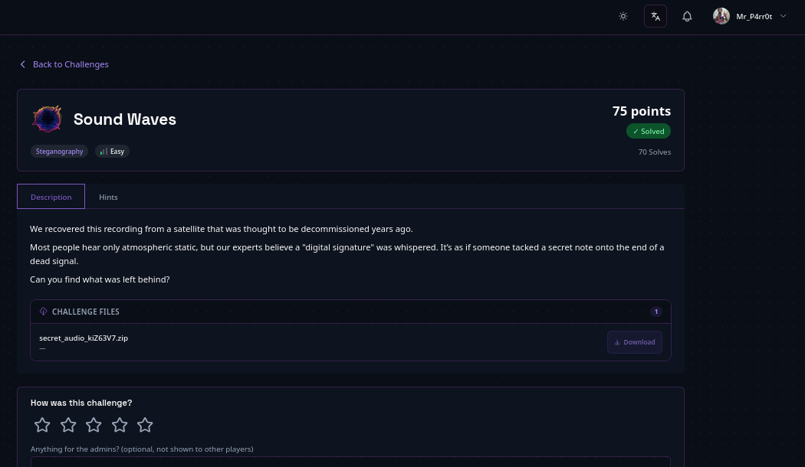

# Sound Waves — Audio Stego

> **Author:** mr.p4rr0t • **Tag:** `#mr.p4rr0t`



> Hidden data in a WAV file: the flag is "tacked onto the end of a dead signal" — appended after the audio data chunk, in the file's slack space.

**Flag:** `[REDACTED]`

## Challenge

A WAV audio file with a hint that data was "tacked onto the end of a dead signal." The flag sits in the file's slack space — after the legitimate audio data chunk, where audio players never look.

## Reconnaissance

1. **Extract and identify the file**

```bash
unzip secret_audio_kiZ63V7.zip
Files: secret_audio.wav

file secret_audio.wav
secret_audio.wav: RIFF (little-endian) data, WAVE audio,
Microsoft PCM, 16 bit, mono 44100 Hz
```

The file is a standard WAV audio file, 264,703 bytes.

2. **Understand the WAV file structure**

WAV files have a chunked format:

- RIFF header (12 bytes)
- `fmt` chunk (audio format info)
- `data` chunk (actual audio samples)

The hint "tacked onto the end of a dead signal" suggests data is appended AFTER the audio data chunk.

## Solution

1. **Parse the WAV structure and check for extra bytes**

```python
with open('secret_audio.wav', 'rb') as f:
    data = f.read()
data_pos = data.find(b'data')
chunk_size = int.from_bytes(data[data_pos+4:data_pos+8], 'little')
data_end = data_pos + 8 + chunk_size
print(f'File size: {len(data)}')
print(f'WAV data ends at: {data_end}')
print(f'Extra bytes: {len(data) - data_end}')
extra = data[data_end:]
print(f'Content: {extra}')
```

Output:

```
File size: 264703
WAV data ends at: 264644
Extra bytes: 59
Content: b'\n\n--- HIDDEN MESSAGE ---\[REDACTED]\n--- END ---\n\n'
```

2. **Extract the flag**

59 extra bytes were found after the WAV data chunk, containing:

```
--- HIDDEN MESSAGE ---
[REDACTED]
--- END ---
```

## Flag

```
[REDACTED]
```

## Understanding the Technique

This is a common steganography technique where data is hidden in a file's "slack space" — the area after the legitimate file data but still within the file.

For WAV files:

- The `data` chunk header specifies the exact byte count of audio.
- Anything beyond that count is ignored by audio players.
- But tools like hex editors, `strings`, or manual analysis can reveal the hidden data.

Why it works:

- Audio players read the data chunk size and stop there.
- The extra bytes don't affect playback.
- The file appears to be a normal WAV file.
- Only careful inspection reveals the hidden content.

## Key Takeaways

- **File format analysis** — understanding WAV file structure (RIFF header, chunks, data chunk with explicit size) is the key to finding appended data.
- **Appended data detection** — check for data beyond the declared file structure.
- **Hint interpretation** — "tacked onto the end" directly described where the flag was hidden.
- **Simple extraction** — sometimes steganography is just appending data after the legitimate file content, relying on parsers to ignore extra bytes.
- **Tools** — Python binary reading, hex editors, or even the `strings` command can reveal appended data.
